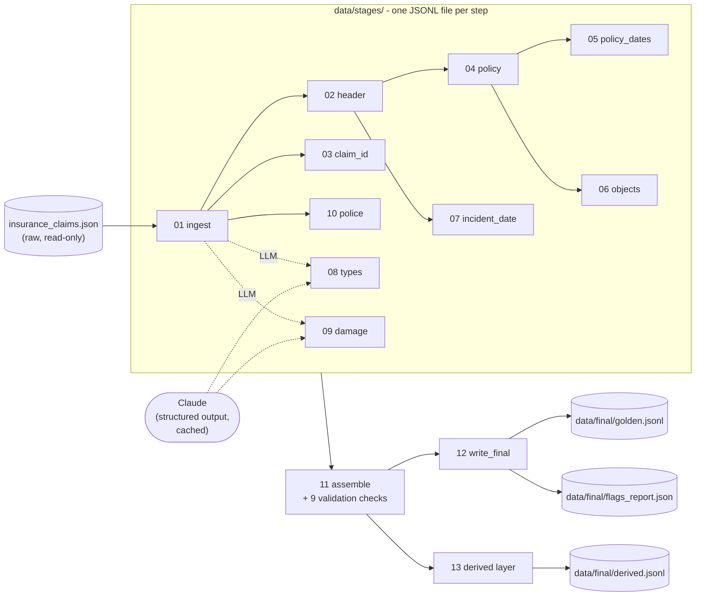

# Insurance Claims Extraction

Turns free-text insurance claim reports (email, phone transcript, portal form, in-person intake) into **consistent, validated JSON records** — "golden data" for evaluating and fine-tuning extraction models.

Every step is its own small module with its own tests, writes its own output file, and never guesses: a value that is not stated (or derivable) in the claim is `null`, and anything doubtful is **flagged for a human reviewer** instead of being silently fixed.

> **Status: working demo.** All 14 pipeline steps are built and tested (144 tests, no network). The two Claude-backed steps (incident type / location type, damage amount) are verified with a fake model only — see [Limitations](#limitations).

---

## Contents

1. [What it does](#what-it-does)
2. [Quick start](#quick-start)
3. [Architecture](#architecture)
4. [The pipeline steps](#the-pipeline-steps)
5. [Data layout](#data-layout)
6. [The golden record](#the-golden-record)
7. [Validation and flags](#validation-and-flags)
8. [How the LLM is used](#how-the-llm-is-used)
9. [Design principles](#design-principles)
10. [Measured accuracy](#measured-accuracy)
11. [Testing](#testing)
12. [Repository layout](#repository-layout)
13. [Limitations](#limitations)
14. [How this was built](#how-this-was-built)

---

## What it does

**Input** — `insurance_claims.json`: 30 claims, each `{claim_text, ground_truth}` (downloaded from the public Hugging Face dataset `Cleanlab/insurance-claims-extraction` by `get_data.py`). The pipeline reads only `claim_text`; `ground_truth` is used by the tests, never by the pipeline.

**Output** — one record per claim with this shape (full schema in the [ADR](adr-01-pipeline_decision.md) §2):

```json
{
  "header":               { "claim_id", "report_date", "incident_date", "reported_by", "channel" },
  "policy_details":       { "policy_number", "policyholder_name", "coverage_type", "effective_date", "expiration_date" },
  "insured_objects":      [ { "object_id", "object_type", "make_model", "year", "location_address", "estimated_value" } ],
  "incident_description": { "incident_type", "location_type", "estimated_damage_amount", "police_report_number" }
}
```

plus the flags that tell a reviewer where to look.

## Quick start

Requirements: Python 3 (developed on 3.14). The pipeline itself uses only the standard library. On macOS/Linux use `python3` where this README says `py`.

```bash
py -m pipeline              # raw claims -> data/stages/ -> data/final/
```

Without an API key every rule-based layer (header, claim ID, policy, dates, objects, police report) is complete, and the three Claude fields are `null` with an `llm_unavailable` error flag. To fill them:

```bash
pip install anthropic                 # only needed for live Claude calls
export ANTHROPIC_API_KEY=...          # PowerShell: $env:ANTHROPIC_API_KEY = "..."
py -m pipeline                        # ~60 calls to claude-opus-5-5; answers are cached
```

Options: `--raw PATH` (input file), `--out DIR` (default `data/`), `--no-llm` (skip steps 8–9).
To run only the stage files: `py -m pipeline.run_stages [raw.json] [out_dir] [--llm]`.

> Running with a key sends the claim text to Anthropic's API. Do not use real customer data unless that is acceptable for you.

Reruns are **byte-identical** and **keep any `review_notes` a human has written** in `data/final/golden.jsonl`.

## Architecture

The design is a staged pipeline where **the files on disk are the interface between steps**. Each step reads earlier stage files, writes only its own, and can be rerun alone.



Three layers, each with one job:

| Layer | Modules | Responsibility |
|---|---|---|
| **Extraction** | `step01` … `step10` | Pure functions: `text (+ earlier results) -> fields`. No I/O, no globals, easy to test. |
| **Orchestration** | `run_stages.py`, `store.py`, `__main__.py` | Run steps in order, persist each step's rows to `data/stages/NN_name.jsonl`, read earlier stages back from disk. |
| **Assembly & output** | `step11` … `step13` | Join the stage rows into the ADR record, run the validation checks, write the final files. |

Why files between steps: you can open any stage and see exactly what that step produced; a step can be rerun or replaced without touching the others; and a rerun is a plain diff.

## The pipeline steps

Follows the written design in [`adr-01-pipeline_decision.md`](adr-01-pipeline_decision.md) (§5). Each step has its own tests in `tests/`.

| # | Stage file | Module | Method | What it extracts |
|---|---|---|---|---|
| 0 | — | `step00_schema.py` | frozen constants | Schema v1.0 and controlled vocabularies; `check_enum` rejects any unknown label |
| 1 | `01_ingest` | `step01_ingest.py` | rules | Working copy of the text (raw is never changed), fixes only *unambiguous* OCR in IDs (`POL-55432I090` → `POL-554321090`) and `Name (Name)` typos, sets `truncated` when the text ends mid-sentence |
| 2 | `02_header` | `step02_header.py` | rules | Channel (from tag, else inferred and flagged), report date (many formats), reporter |
| 3 | `03_claim_id` | `step03_claim_id.py` | rules | `CLM-nnnnnn`, preferring the one next to a "claim ref/number" label |
| 4 | `04_policy` | `step04_policy.py` | rules | `POL-nnnnnnnnn` (partial/garbled → null), policyholder (may differ from the caller), coverage type; ignores relatives' policies |
| 5 | `05_policy_dates` | `step05_policy_dates.py` | rules | Effective/expiration dates: explicit date → partial date anchored to the report date → duration (`expiration = effective + term − 1 day`) → `DD/MM/YY` format hint → null |
| 6 | `06_objects` | `step06_objects.py` | rules | Vehicles (VIN, make/model, year, value) or building (id, type, year, address, value); only value wording counts, never damage quotes |
| 7 | `07_incident_date` | `step07_incident_date.py` | rules | Explicit date > weekday + day-of-month (verified) > relative phrase ("yesterday", "two days ago") > bare weekday; conflicts are flagged |
| 8 | `08_types` | `step08_types.py` | **Claude** | `incident_type`, `location_type` from the 14 + 7 allowed labels, or `none_fit` |
| 9 | `09_damage` | `step09_damage.py` | **Claude**, verified | Repair/replacement estimate; kept only if the model's quote is really in the text and contains the number |
| 10 | `10_police` | `step10_police.py` | rules | `PR-nnnnnnnn-nnnn`, else null |
| 11 | — | `step11_validate.py` | rules | Assemble the record, run the 9 validation checks |
| 12 | `final/` | `step12_output.py` | rules | `golden.jsonl` and `flags_report.json` |
| — | `final/` | `step13_derived.py` | rules | `is_active_at_incident` (kept out of the golden schema) |

## Data layout

```
insurance_claims.json        raw input - never modified
data/
  stages/                    one deterministic JSONL file per step
    01_ingest.jsonl ... 10_police.jsonl
  final/
    golden.jsonl             the finished records (one per line)
    flags_report.json        records needing review, worst first
    derived.jsonl            is_active_at_incident per claim
  llm_cache/                 saved Claude answers (hash of model+prompt+schema)
```

A stage row holds only that step's fields, keyed by a stable id:

```json
{"channel":"Email","id":"rec-001","report_date":"2024-04-22","reported_by":"Jennifer Garcia"}
```

Files are written with sorted keys, UTF-8 and LF endings, so identical input always yields identical bytes. `data/` is in `.gitignore`; the generated files committed earlier stay tracked.

## The golden record

Each line of `data/final/golden.jsonl` follows ADR §7:

```json
{"id": "rec-001", "version": "v1.0", "raw_text": "...", "golden": { ... }, "flags": [ ... ], "review_notes": ""}
```

- `raw_text` is the untouched original claim.
- `flags` is the machine-generated list (below).
- `review_notes` is **for the human reviewer** and is preserved across reruns.

`policy_details` and `insured_objects` are `null` when the claim states no valid policy number, as the ADR specifies. Until a reviewer has gone through the flagged records, treat the output as a *draft* golden set.

## Validation and flags

Step 11 runs the nine checks from ADR §6. It **flags and never auto-fixes**.

| # | Check | Severity | Flag code |
|---|---|---|---|
| 1 | IDs match their regex | Error | `bad_id` |
| 2 | Enums are in the vocabulary; required ones are not null | Error | `bad_enum`, `missing_required` |
| 3 | `incident_date <= report_date` | Error | `incident_after_report` |
| 4 | `effective_date < expiration_date` | Error | `bad_policy_window` |
| 5 | Coverage matches object type (Auto → Vehicle) | Error | `coverage_object_mismatch` |
| 6 | Amounts are positive integers | Error | `bad_amount` |
| 7 | Police-report date ≈ incident date (±3 days) | Warning | `police_date_mismatch` |
| 8 | Incident inside the policy window | Info | `incident_outside_policy_window` |
| 9 | Non-null values traceable to the text | Warning | `not_traceable` |

Steps add their own flags: `truncated`, `channel_inferred`, `holder_inferred`, `weekday_mismatch`, `incident_date_conflict` (step 7), `taxonomy_gap:*`, `invalid_label:*` (step 8), `invalid_amount`, `amount_not_in_text` (step 9), and `llm_unavailable` / `stage_missing` (Error). A flag is `{code, severity, field, message}`.

## How the LLM is used

Only for the genuinely fuzzy fields (steps 8 and 9). Everything else is deterministic rules.

- **Model:** `claude-opus-5-5` via the official `anthropic` SDK; one constant, `MODEL` in `pipeline/llm.py`.
- **Structured output:** responses are constrained with a JSON schema (`output_config.format`); the schema's enum is the frozen vocabulary plus `none_fit`.
- **Closed vocabulary:** `none_fit` becomes `null` plus a `taxonomy_gap` flag — the model can never invent a label. Anything outside the vocabulary is rejected.
- **Verified, not trusted:** for the damage amount the model must return the exact quote it used; the code checks the quote is in the claim and contains the number, otherwise the value is dropped and flagged.
- **Claim text is data:** it is passed inside `<claim>` tags with an instruction to ignore instructions found there.
- **Cached:** each answer is stored in `data/llm_cache/` under a hash of model + prompt + schema, so reruns are free and identical. Only the answer is stored — never the API key or the claim text.
- **Fails safe:** no key, refusal, truncated or malformed answer, or an API error → the field is `null` with `llm_unavailable`. The refusal fallback (`fallbacks="default"`) is enabled.
- **Provenance:** every LLM stage row records the `model` and `prompt_version`.

## Design principles

These were fixed before any code was written (recorded as project invariants alongside `SPEC.md`) and are enforced by tests:

1. **Never guess.** Not stated and not derivable → `null`.
2. **Never invent a label.** An unfit situation is flagged, not forced into the nearest enum.
3. **Raw text is immutable.** Work happens on a copy; `raw_text` is stored byte for byte.
4. **Faithfulness.** Extract what is stated, even if the policy had expired.
5. **Flag, don't fix.** Validation reports problems; a human decides.
6. **Reproducible.** Same input → same bytes. LLM answers are cached and versioned.
7. **Documented gaps.** Where a rule cannot match the dataset's label, the test lists the record and fails if the gap ever closes unnoticed.

## Measured accuracy

Agreement of the **rule-based** steps with the dataset's `ground_truth` (30 claims; policy-dependent steps are measured on the 25 claims that state a policy number):

| Step | Match | Known misses (frozen in the tests) |
|---|---|---|
| Header (channel, report date, reporter) | 30 / 30 | — |
| Claim ID | 30 / 30 | — |
| Policy number, holder, coverage | 29 / 30 | record 7: liability coverage is only implied |
| Policy dates | 24 / 25 | record 14: label uses +1 year, the ADR rule is +1 year − 1 day (ADR §9 #4) |
| Insured objects | 22 / 25 | record 4 build year (inferred from a birthday); records 7 and 12 values differ from the stated figure (ADR §9 #2/#3) |
| Incident date | 30 / 30 | — |
| Police report number | 30 / 30 | — |

The reference record in ADR §8 assembles into **exactly** the §8.3 golden output. With ground-truth labels standing in for Claude, all 30 records assemble with **zero Error flags**.

**Steps 8 and 9 (Claude) have not been measured against live Claude** — the tests prove the wiring and the safety rules with a fake model. 25 of the 26 ground-truth damage amounts appear literally in the claim text; the exception (record 14, label 37098 vs "over $37,000") is deliberately rejected as untraceable.

## Testing

144 tests, standard library only, no network (Claude is replaced by a fake client).

```bash
py -m unittest tests.test_step00_schema tests.test_step01_ingest tests.test_step02_header \
  tests.test_step02_fix tests.test_step03_claim_id tests.test_step04_policy \
  tests.test_step05_policy_dates tests.test_step06_objects tests.test_step07_incident_date \
  tests.test_step08_types tests.test_step09_damage tests.test_step10_police \
  tests.test_step11_validate tests.test_step12_output tests.test_step13_derived \
  tests.test_run_stages tests.test_run_stages_llm tests.test_llm tests.test_main
```

(`unittest discover` is not used because `tests/` is a namespace package.) Shared fixtures — the ADR reference record and the 30 claims — live in `tests/test_step01_ingest.py`.

## Repository layout

```
adr-01-pipeline_decision.md  design: schema, vocabularies, rules, validation, review workflow
SPEC.md                      approved specification (FR-*, NFR-*, AC-*)
get_data.py                  downloads the dataset (needs the `datasets` package)
insurance_claims.json        the 30 raw claims
pipeline/
  __main__.py                `py -m pipeline` - end to end
  run_stages.py  store.py    stage runner and the JSONL stage store
  llm.py                     Claude client: cache, structured output, fail-safe
  step00_schema.py ... step13_derived.py
tests/                       one test module per step + runner/CLI/LLM tests
data/                        generated output (stages/, final/, llm_cache/)
AGENTS.md  CLAUDE.md         instructions for AI coding agents working in this repo
```

## Limitations

- **Claude steps are unmeasured.** Incident type, location type and damage amount have not been run against live Claude yet; expect to review the first output.
- **Rule-based extraction is tuned to this 30-claim sample.** It generalises through broad patterns and synthetic tests, but new phrasing will produce `null` or a flag rather than a wrong value — that is by design, not a guarantee of coverage.
- **Single reviewer.** There is no second annotator, so the ADR's adjudication step is dropped; flags and traceability checks are the only safety net.
- **The dataset's own label problems** (ADR §9) are out of scope: the pipeline neither corrects nor tracks them, and never edits `ground_truth`.
- **Privacy.** With a key set, claim text goes to Anthropic. The cache and stage files contain claim text/derived data — treat `data/` accordingly.
- **Staleness.** The committed files under `data/` are a snapshot from a run *without* an API key (Claude fields empty). Rerun with a key to refresh them.

## How this was built

Spec-first with the [Genesis](https://github.com/ayush488-glitch/genesis-kit) workflow: a written specification (`SPEC.md`, 14 functional / 5 non-functional requirements, 9 acceptance criteria) was approved before any code, then each pipeline step was built as its own gated task — tests first, then code, then a passing test gate. Medium-risk tasks (the Claude client and steps 8–9) also required an independent human review. The workflow state lives in a local `.genesis/` folder that is intentionally not committed.
